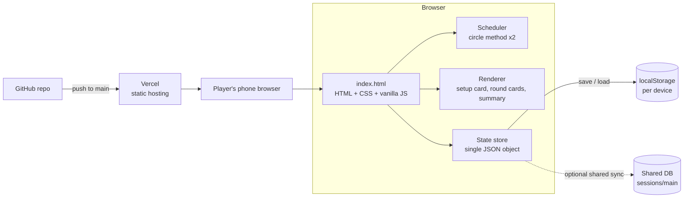

# 🏸 Badminton Doubles Scheduler

A tiny web app for casual badminton groups. Enter the players, and it builds a **fair doubles schedule**: partners rotate every round, every team plays every other team, and nobody plays more than anyone else.

No scores, no leaderboard, no accounts. Just who plays with whom, and what has been played.

**Live demo:** `https://badminton-scheduler-mauve.vercel.app/`

---

## Features

- Works with **any number of players** (4, 6, 8, 20 and so on)
- **Teams of 2 per round**, where every team plays every other team once
- **Partners rotate every round.** With an even player count, every pair partners exactly once over the full cycle
- **Fair rests.** Odd player counts give one player a rest per round, and it rotates
- **Match status buttons:** Playing / Played / not played, with a per-round progress counter
- **Per-player table** of matches played so far
- **Mobile-first**, with automatic light and dark mode
- **Zero dependencies and no build step**

---

## How the scheduling works

The old approach picked 4 players per round and left the rest sitting out, which gave uneven game counts. This version is fair by construction.

### 1. Pair players into teams (circle method)

The players are shuffled once. A fixed seat and a rotating ring then give `N-1` rounds, each pairing all players into teams of 2. Over the full cycle, every pair of players is partnered exactly once.

```
Round 1:  A-F  B-E  C-D
Round 2:  A-E  F-D  B-C   (everyone except A rotates one seat)
...
```

If `N` is odd, a dummy "bye" player is added. Whoever is paired with the dummy sits out that round.

### 2. Play every team against every other team

Inside a round, the same circle method is applied to the teams. This produces all team-vs-team matches and orders them so the same team rarely plays back to back.

| Players | Teams per round | Matches per round | Each player plays |
|---------|-----------------|-------------------|-------------------|
| 4 | 2 | 1 | 1 of 1 |
| 6 | 3 | 3 | 2 of 3 |
| 8 | 4 | 6 | 3 of 6 |

Every player is on court for the same number of matches in a round, so game counts stay equal.

---

## Architecture



### Data flow

1. The user adds names, and `state.players` is updated.
2. **Create schedule** calls `build(players)`, which fills `state.rounds`.
3. Pressing **Playing** or **Played** changes `match.s` and re-renders.
4. Every change is saved through `save()`. The page loads again from the saved state after a refresh.

### Data model

One JSON document holds everything:

```json
{
  "players": ["nikka", "sakthi", "umesh", "dk", "arun", "gopi"],
  "rounds": [
    {
      "teams": [["nikka", "dk"], ["sakthi", "arun"], ["umesh", "gopi"]],
      "bye": [],
      "matches": [
        { "a": 0, "b": 1, "s": 0 },
        { "a": 0, "b": 2, "s": 2 }
      ]
    }
  ]
}
```

`s` is the match status: `0` = not played, `1` = playing, `2` = played.

### Code layout

| Function | Responsibility |
|----------|----------------|
| `circle(items)` | Round-robin pairing, used for both players and teams |
| `build(names)` | Builds all rounds, teams, byes and match order |
| `save()` / `load()` / `connect()` | Persistence and optional shared sync |
| `renderSetup()` / `renderOut()` | UI for the setup card and the round cards |
| `setStatus(r, m, s)` | Toggles a match status |

---

## Tech stack

| Layer | Choice |
|-------|--------|
| Frontend | Plain HTML, CSS and vanilla JavaScript (single file) |
| Scheduling | Circle (round-robin) method |
| Storage | Browser `localStorage`, with an optional shared document store |
| Hosting | Vercel (static site), deployed from GitHub |
| CI/CD | Automatic redeploy on every push to `main` |

---

## Run locally

```bash
git clone https://github.com/Adhavan07/badminton-scheduler.git
cd badminton-scheduler
# open index.html in a browser, or serve it:
python3 -m http.server 8000
```

## Deploy

1. Push the repo to GitHub.
2. In Vercel, choose **Add New → Project** and import the repo.
3. Set the framework preset to **Other**, and leave the build command and output directory empty.
4. Click **Deploy**. Every push to `main` redeploys automatically.

---

## Known limitations

- On a plain static host, state lives in each device's browser, so players on different phones do not see each other's match statuses. One person can run the session and share their screen.
- Once a schedule is created, the player list is locked. Use **Start a new session** to change it.

## Roadmap

- [ ] Shared live sync across phones (Firebase Firestore or Supabase)
- [ ] "Copy schedule as text" for WhatsApp
- [ ] Saved player lists
- [ ] Installable PWA
- [ ] Optional multiple courts

---

## License

MIT
